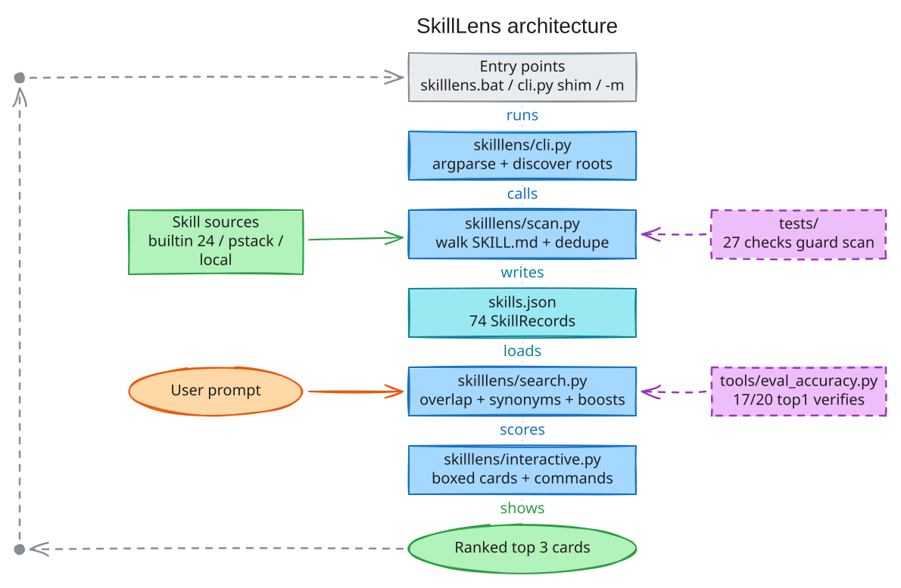

# SkillLens

Prompt in, ranked skills out.

Suggest-only skill search over local `SKILL.md` files. No auto-invoke.

## Architecture



What it is. You type a normal prompt. SkillLens ranks the skills you
have installed and shows the top matches as cards. Each card carries
the skill name, its full description, why it matched, and the exact
`@skill` line to use. Nothing runs on its own. You copy the line you
want.

How it works. `scan.py` walks your skill folders plus 24 built-in
skills and writes one `skills.json` index. `search.py` scores your
prompt against that index with word overlap, synonyms, and small
intent boosts. `interactive.py` prints the ranked cards and offers
copy, top N, roots, and help commands.

## Setup

```sh
python -m skilllens.cli --rebuild-index   # build skills.json from discovered skill roots
```

## Skill sources

`scan.discover_roots()` collects roots in order; later roots win on
key collision (local/project beat pstack, custom beats all):

1. `pstack` — upstream checkout
   `C:\Users\jayes\.config\opencode\pstack-upstream\pstack\skills` (skipped if missing)
2. `local` — global config, any that exist:
   `%USERPROFILE%\.config\opencode\skills`,
   `%APPDATA%\opencode\skills`,
   `C:\Users\jayes\.config\opencode\skills`
3. `project` — repo-local: walk up from cwd (max 4 levels) for
   `.opencode/skills/` and `skills/` dirs
4. `custom` — config file at the repo root (or next to `scan.py` inside
   `skilllens/` for compat) (`skill-sources.json`
   or `skillsources.json`): list of `{"path": "...", "source": "custom"}`
   or plain strings. `%VARS%` expanded, relative paths resolve against
   the repo root. Missing entries are skipped with an stderr note.
5. `custom` — env override `SKILL_SEARCH_ROOTS`
   (`os.pathsep`-separated paths).

Config file example (`skill-sources.json`):

```json
[
  {"path": "%USERPROFILE%/.config/opencode/extra-skills", "source": "custom"},
  "relative-skills"
]
```

Each root is walked recursively (`os.walk`); any `SKILL.md` at any
depth is indexed with an absolute path and its root's source.

Rank order on key collision (file copies always win ties; local beats
pstack, project beats local, custom beats all):

`builtin` (0) < `pstack` (1) < `local` (2) < `project` (3) < `custom` (4)

### Built-in skills

`skilllens/builtin_skills.py` lists 24 opencode skills (`grill-me`, `diagnose`,
`tdd`, ...) that have no `SKILL.md` on disk. `scan.py` indexes them as
`SkillRecord`s with `source: "builtin"` and `path: "opencode:<name>"`
(summary = description). They appear first in `discover_roots()` as the
virtual `("builtin", "builtin")` root, so `--list-roots` shows them with
their count; freshness checks ignore the virtual root (no mtime).

### Synonym scoring

`skilllens/search.py` expands prompt tokens with `SYNONYMS` siblings (e.g.
`ask`→`grill`/`interview`/`quiz`, `architecture`→`design`/`structure`,
`understand`→`learn`/`comprehend`, `debug`→`diagnose`/`fix`,
`test`→`tdd`). Synonym matches score 0.5x a direct match in every field
weight class and add `+ N synonym hit(s)` to the reason.

Freshness: the index is stale when any `SKILL.md` is newer than
`skills.json`. `cli.py --prompt` and `interactive.main()` auto-rescan
first (`index refreshed: N skills` on stderr).

## Usage

```sh
python cli.py --prompt "how does login work"
python -m skilllens.cli --prompt "how does login work"
python -m skilllens.cli --prompt "design module structure before coding"
python -m skilllens.cli --rebuild-index --prompt "how does auth work"
python -m skilllens.cli --list-roots
python -m skilllens.cli --roots D:\extra-skills --prompt "how does auth work"
python cli.py --interactive
```

`cli.py` at the root is a thin shim over the `skilllens` package, so
`python cli.py ...` and `python -m skilllens.cli ...` behave the same.

One-shot `--prompt` output: boxed cards (one per suggestion with
name/score/source header, path, reason, and `@skill <prompt>` use line)
when stdout is a tty and `NO_COLOR` is unset; plain text otherwise.
Copy the use line you want; nothing runs automatically.

`--list-roots` prints discovered roots with `SKILL.md` counts.
`--roots DIR` adds an extra root (repeatable, source `custom`).
`--rebuild-index` re-runs the scan before suggesting.

## Interactive mode

```sh
python cli.py --interactive
python -m skilllens.cli --interactive
```

Banner:

```text
SkillLens — Prompt in, ranked skills out
Type a prompt. 1-3 copies a result. help shows commands. exit quits.
```

| Command | Action |
|---|---|
| `<prompt>` | search skills for this prompt |
| `1`-`9` | copy result N as `@skill <prompt>` via `clip` |
| `top N` | set result count live (e.g. `top 5`); `top` shows current |
| `roots` | print discovered roots inline |
| `clear` | clear screen (`cls` on Windows, `clear` elsewhere) |
| `help` | list commands |
| `exit` / `quit` | quit (also Ctrl-C) |

Colors are ANSI with a `NO_COLOR` env + non-tty fallback to plain boxes
(same info). Each prompt turn opens with a framed header
(`+-- prompt #N --+`, or plain `--- prompt #N ---` without color) and
results close with a thin `-` rule, so turns never visually merge.
Windows PowerShell compatible, Python stdlib only.

## Use from anywhere

One-time setup. Run `install.bat`. It adds this folder to your user
`PATH`. Restart the terminal. Then the command works in any folder.

```sh
skilllens --prompt "how does login work"
skilllens --interactive
skilllens --list-roots
```

No install alternative. Call it by full path from anywhere.

```sh
F:\skill-search-engine\skilllens.bat --prompt "how does login work"
```

Project skills still resolve by working directory. Discovery walks up
from wherever you run, so repo-local `.opencode/skills` get picked up
automatically. The index file itself always lives at the repo root
(`skills.json`, next to `cli.py`), resolved via the package parent dir,
so it is found from any working directory.

## Tests

```sh
python -m pytest tests/
python tests/test_search.py
python tests/test_interactive.py
python tests/test_ranking_bias.py
python tests/test_discovery.py
python tests/test_brand.py
python tests/test_grill.py
python tests/test_ui.py
python tools/eval_accuracy.py
```

Each test file inserts the repo root into `sys.path`, so per-file runs
work from the root without extra setup.

## Files

- `cli.py` — thin root shim (delegates to `skilllens.cli`; used by `skilllens.bat`)
- `skilllens/` — package: `__init__.py`, `brand.py` (brand single source),
  `builtin_skills.py`, `scan.py` (index builder, stdlib only),
  `search.py` (pure scoring logic), `cli.py` (argparse CLI),
  `interactive.py` (interactive terminal loop: boxed cards, framed
  prompt headers, commands)
- `skills.json` — generated index
- `docs/architecture.svg` — architecture diagram (repo root)
- `tests/` — `test_search.py` (smoke tests), `test_discovery.py` (root
  discovery / recursive scan / dedupe tests), `test_brand.py` (brand +
  interactive command tests), `test_grill.py`, `test_ranking_bias.py`,
  `test_interactive.py`, `test_ui.py` (card rendering + prompt header tests)
- `tools/eval_accuracy.py` — 20-prompt accuracy eval
